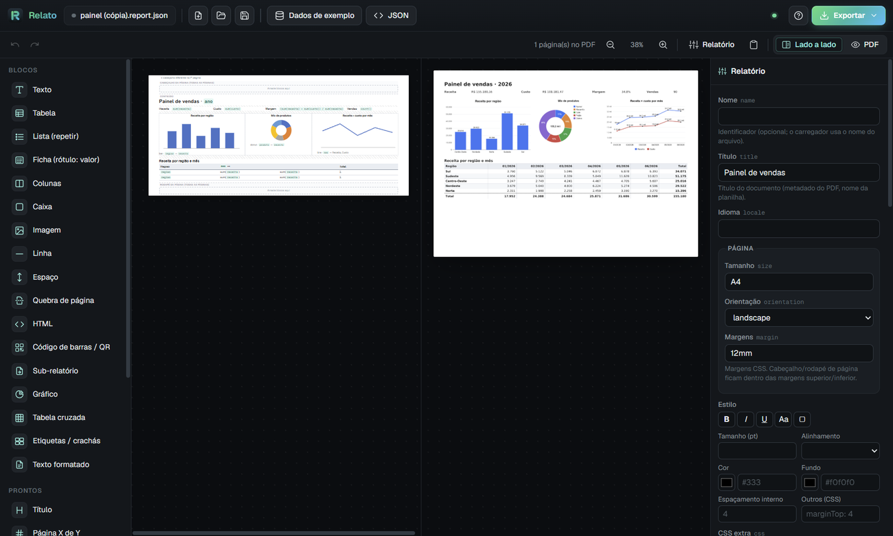

# Prelo

[English](README.md) · Português

Relatórios PDF/XLSX para Java (Spring, Quarkus, puro) a partir de um JSON declarativo, com plugin IntelliJ que mostra o preview enquanto você edita. É uma alternativa leve ao JasperReports.

- **Template `*.report.json`**: cabeçalho e rodapé de página, tabelas com grupos, subtotais e total geral, listas mestre-detalhe, fichas, imagens e colunas.
- **Paginação de verdade**: cabeçalho da tabela repetido em cada página, `Página X de Y` e quebra por grupo.
- **Expressões** `${cliente.nome}`, `${sum(valor)}`, `${qtd * preco}`, `${ativo ? 'Sim' : 'Não'}`.
- **Saídas**: PDF (OpenHTMLtoPDF/PDFBox), XLSX tipado (números e datas reais), HTML e CSV.
- **Além de listagens**: gráficos, tabela cruzada, etiquetas/crachás, contratos em Markdown, cobrança com QR Pix e boleto, PDF com senha. Veja a [galeria](docs/GALERIA.md).
- **Licenças livres**: LGPL (openhtmltopdf) e Apache 2 (PDFBox, fastexcel, Jackson).

| Módulo | O que é |
|---|---|
| `prelo-core` | engine (Java 17+, sem framework) |
| `prelo-fonts` | opcional: DejaVu Sans (Unicode completo) como fonte padrão |
| `prelo-jrxml` | migração de `.jrxml` (JasperReports) para `.report.json` (CLI + usado pelo plugin) |
| `prelo-spring-boot-starter` | bean `Prelo` + `ReportResponses` para controllers |
| `prelo-quarkus` | producer CDI (`@Inject Prelo`) + `ReportResponses` JAX-RS |
| `prelo-server` | linha de comando (`render`, `check`) e serviço HTTP para gerar relatórios de qualquer linguagem |
| `prelo-intellij` | plugin: designer visual, editor JSON com preview, campos a partir de DTO, migração de `.jrxml` |
| [`prelo-desktop`](prelo-desktop) | app Windows (Electron) com o mesmo designer e Java embutido: monta e exporta relatórios sem IDE |



## Instalar

Gradle:
```kotlin
repositories { mavenCentral() }
dependencies {
    implementation("io.github.mateusvpassos:prelo-spring-boot-starter:0.1.0") // Spring
    // ou prelo-quarkus (Quarkus) / prelo-core (qualquer Java)
    // opcional: implementation("io.github.mateusvpassos:prelo-fonts:0.1.0")    // Unicode completo
}
```

Maven:
```xml
<dependency>
  <groupId>io.github.mateusvpassos</groupId>
  <artifactId>prelo-spring-boot-starter</artifactId>
  <version>0.1.0</version>
</dependency>
```

Versão em desenvolvimento: `./gradlew publishToMavenLocal` publica `0.1.0-SNAPSHOT` em `~/.m2` (use `mavenLocal()`).

Plugin IntelliJ: JetBrains Marketplace (*Prelo Reports*), ou `./gradlew :prelo-intellij:buildPlugin` → `Settings → Plugins → ⚙ → Install Plugin from Disk…` → `prelo-intellij/build/distributions/prelo-intellij-0.1.0.zip`.

Passo a passo com projetos de teste: [TUTORIAL.md](TUTORIAL.md) (`demo-spring/` e `demo-quarkus/`).
Como o código está organizado (para quem vai mexer): [ARCHITECTURE.md](ARCHITECTURE.md).

> Build: rode o Gradle com o JBR da IDE (`JAVA_HOME="C:/Users/.../IntelliJ IDEA/jbr"`); o plugin usa a IDE local como SDK (`ideaLocalPath` em `gradle.properties`).

## Usar

Templates ficam em `src/main/resources/reports/` (`vendas.report.json`).

**Spring**
```java
@RestController
class RelatoriosController {
    private final Prelo prelo;
    private final VendaService vendas;

    @GetMapping("/relatorios/vendas")
    ResponseEntity<byte[]> vendas(@RequestParam String periodo) {
        var report = prelo.report("vendas").data(vendas.doPeriodo(periodo)).param("periodo", periodo);
        return ReportResponses.inline(report, Format.PDF, "vendas-" + periodo);   // ou download(...), Format.XLSX
    }
}
```
Propriedades (Spring e Quarkus), com os valores padrão:
```properties
prelo.templates=classpath:reports/        # ou file:/caminho/reports (edita sem recompilar)
prelo.cache=true                          # false em dev
prelo.locale=pt-BR
prelo.zone=America/Sao_Paulo
prelo.date-pattern=dd/MM/yyyy
prelo.date-time-pattern=dd/MM/yyyy HH:mm
prelo.chunk-rows=4000                     # acima disso o PDF sai em blocos (ver "Relatórios grandes"); 0 desliga
```

**Quarkus** (`io.github.mateusvpassos:prelo-quarkus:0.1.0`)
```java
@Path("/relatorios")
public class RelatoriosResource {
    @Inject Prelo prelo;   // configurado por application.properties (prelo.templates, prelo.cache...)

    @GET @Path("/vendas")
    public Response vendas(@QueryParam("formato") @DefaultValue("pdf") String formato) {
        return ReportResponses.inline(prelo.report("vendas").data(service.vendas()), Format.of(formato), "vendas");
    }
}
```
Projeto de teste: [`demo-quarkus/`](demo-quarkus). Testado em modo JVM; native image não foi validado (PDFBox/AWT).

**Java puro**
```java
Prelo prelo = Prelo.builder().templates(TemplateLoader.classpath("reports/")).build();
byte[] pdf  = prelo.report("vendas").data(lista).param("periodo", "09/2026").pdf();
byte[] xlsx = prelo.report("vendas").data(lista).xlsx();
byte[] csv  = prelo.report("vendas").data(lista).csv();   // 1ª tabela, ';' e vírgula decimal (Excel pt-BR)
prelo.report("vendas").data(lista).pdf(outputStream);
```

Dados aceitos: `List`/coleção (vira `rows`, fonte padrão das tabelas), objeto único (propriedades acessíveis direto), records, POJOs com getters, `Map`. JDBC: `Rows.of(resultSet)`.

Comportamentos úteis (iguais aos do Jasper):
- Parâmetro não informado vale `null`, sem erro.
- Com dados em lista, um campo usado fora de tabela/lista (ex.: no cabeçalho de página) lê o 1º registro.
- Imagem cujo caminho vem de expressão e não existe é omitida; um caminho fixo inexistente dá erro.

Erros de template ou de expressão apontam o bloco e o campo: `body[1].columns[0].value: 'vlor' não encontrado (disponíveis na linha: valor, ...)`.

## Template

```json
{
  "title": "Relatório de Vendas",
  "page": { "size": "A4", "orientation": "portrait", "margin": "22mm 12mm 18mm 12mm" },
  "parameters": [ { "name": "periodo", "type": "string", "sample": "09/2026" } ],
  "fields": [ { "name": "regiao", "type": "string" }, { "name": "valor", "type": "money" } ],
  "pageHeader": [ { "type": "text", "value": "Vendas · ${periodo}", "style": { "bold": true, "size": 12 } }, { "type": "line" } ],
  "body": [
    { "type": "table", "sortBy": "regiao, -valor", "zebra": true,
      "groups": [ { "by": "regiao", "header": "Região: ${regiao} (${count()})", "footer": true } ],
      "columns": [
        { "header": "#", "value": "${index}", "width": "8%" },
        { "header": "Cliente", "value": "${cliente.nome}" },
        { "header": "Valor", "value": "${valor}", "format": "currency", "total": "sum", "width": "20%" }
      ] }
  ],
  "pageFooter": [ { "type": "text", "value": "Página ${page} de ${pages}", "align": "right" } ]
}
```

Exemplos completos: [`examples/`](examples) e a [galeria](docs/GALERIA.md) com imagens (painel com gráficos, cobrança Pix, etiquetas, crachás, contrato).

### Blocos (`type`)

| type | Para quê | Principais propriedades |
|---|---|---|
| `text` | texto com expressões | `value`, `format`, `align` |
| `table` | lista tabular paginada | `source` (padrão `rows`), `columns[]` (`header value width align format total`), `groups[]` (`by header footer footerLabel pageBreak`), `sortBy`, `zebra`, `grid`, `totalLabel`, `emptyText` |
| `list` | repete blocos por item (mestre-detalhe, fichas) | `source`, `as`, `content[]`, `header[]`, `footer[]`, `separator`, `keepTogether`, `pageBreakBetween` |
| `fields` | grade rótulo: valor | `items[]` (`label value format span`), `columns`, `labelWidth` |
| `row` | colunas lado a lado | `columns[]` (`width align content[]`), `gap` |
| `box` | agrupa com estilo / sem quebrar | `content[]`, `keepTogether` |
| `image` | imagem | `src` (`classpath:`, arquivo, URL, data URI, `${bytes}`), `width`, `height`, `align` |
| `html` | escape hatch (XHTML) | `value` |
| `barcode` | código de barras / QR | `value`, `format` (`qr code128 code39 ean13 ean8 upca itf datamatrix pdf417`), `width`, `height`, `showText` |
| `include` | sub-relatório (corpo de outro template) | `template`, `data`, `params` |
| `chart` | gráfico (imagem nítida no PDF) | `chartType` (`bar hbar line area pie donut`), `label`, `value` ou `series[]` (`name value color`), `title`, `width`, `height`, `format`, `sortBy`, `limit`, `legend`, `showValues`, `colors` |
| `crosstab` | tabela cruzada (pivot) com totais | `rows`, `columns`, `value`, `aggregate` (`sum count avg min max`), `format`, `rowHeader`, `totals`, `sortColumns` |
| `labels` | etiquetas, crachás, cartões em grade | `columns`, `rowsPerPage`, `width`, `height`, `gap`, `padding`, `border`, `copies`, `content[]` |
| `markdown` | texto longo formatado (contratos, cartas) | `value` (`# título`, `**negrito**`, `*itálico*`, listas, `>` citação, `---`), `align` |
| `line` `spacer` `pageBreak` | | `color thickness` / `height` |

Todos aceitam `style` e `visible` (expressão; ex.: `"visible": "obs != null"`).

`style`: texto CSS ou objeto. Atalhos: `bold italic underline uppercase size align valign font color background border`. Outras chaves viram CSS (`marginTop: 4` → `margin-top:4pt`).

**Estilo condicional**: valores de `style` aceitam expressões, avaliadas por bloco e, no `style` de coluna, por linha da tabela:
```json
{ "header": "Saldo", "value": "${saldo}", "format": "currency", "style": { "color": "${saldo < 0 ? '#c0392b' : ''}", "bold": true } }
```
Uma propriedade que resulta vazia é descartada.

### Recursos de página

```json
{
  "watermark": { "text": "CANCELADO", "visible": "status == 'C'" },
  "firstPageHeader": [ { "type": "text", "value": "Capa: só na 1ª página" } ],
  "body": [
    { "type": "table", "pageTotals": true, "columns": [ { "header": "Valor", "value": "${valor}", "total": "sum" } ] },
    { "type": "barcode", "value": "${chaveNota}", "format": "qr", "width": "30mm" },
    { "type": "barcode", "value": "${codigo}", "format": "code128", "showText": true },
    { "type": "include", "template": "itens-pedido", "data": "itens", "params": { "titulo": "Itens do ${numero}" } }
  ]
}
```
- **`watermark`**: texto ou imagem em todas as páginas, transparente e por baixo do conteúdo.
- **`firstPageHeader`**: cabeçalho próprio da 1ª página; nas outras vale `pageHeader`.
- **`pageTotals`** na tabela: "A transportar" no pé de cada página e "Transporte" no topo da seguinte, com o acumulado das colunas `total: "sum"`. Os rótulos mudam em `carryLabel` e `broughtLabel`.
- **`barcode`**: `qr`, `code128`, `code39`, `ean13`, `ean8`, `upca`, `itf`, `datamatrix`, `pdf417`.
- **`include`**: corpo de outro template (sub-relatório reaproveitável), com os dados e parâmetros que você passar.
- **`metadata`** (`author subject keywords creator`) e **`security`** (`userPassword`, `ownerPassword`, `allowPrint`, `allowCopy`, `allowModify`; AES-256) no PDF. Ambos aceitam expressões: `"security": { "userPassword": "${cpf}" }` gera o extrato que abre com o CPF do cliente.
- **Unicode completo** (✓ ★ → Ω €, grego, cirílico): adicione `io.github.mateusvpassos:prelo-fonts:0.1.0`. Com o jar no classpath, DejaVu Sans vira a fonte padrão.

### Expressões

- **Textos** (`value`, `header`, `label`...) usam `${...}`: `"Total: ${sum(valor)}"`.
- **Propriedades lógicas** (`source`, `visible`, `by`, `sortBy`) aceitam com ou sem `${}`: `"source": "itens"`.
- Navegação nulo-segura (`cliente.endereco.cidade` → vazio se nulo), índice `itens[0]`, `mapa['chave']`.
- Operadores: `+ - * / %`, `== != < <= > >=`, `&& || !` (`and or not`), `a ? b : c`, `a ?? b`.
- Variáveis: `rows`, `data`, `param.x` (ou só `x`), `index` (linha/item), `page`, `pages`, `groupKey`.
- Agregações (no escopo corrente: grupo, tabela, lista ou dados): `sum avg min max count first last join`. Exemplos: `sum(valor)`, `sum(itens, qtd * preco)`, `count()`, `count(itens)`.
- Funções: `format(v, 'padrão') upper lower trim text number len isEmpty coalesce contains replace substr round abs if values keys today now`.
- Pagamentos (Brasil):
  - `pix(chave, valor, nome, cidade, txid, descricao)`: BR Code do Pix estático (o "copia e cola"). Use como `value` de um `barcode` `qr` ou mostre como texto. Só a chave é obrigatória.
  - `boleto(linhaDigitavel)`: converte a linha digitável (47 dígitos, ou 48 de convênio) nos 44 dígitos do código de barras, para `barcode` `itf`.
  ```json
  { "type": "barcode", "format": "qr", "value": "${pix(chave, total, 'MINHA EMPRESA', 'CURITIBA', numero)}", "width": "40mm" },
  { "type": "barcode", "format": "itf", "value": "${boleto(linha)}", "width": "103mm", "height": "13mm" }
  ```

### Formatos (`format`)

`currency`, `number`, `integer`, `decimal`, `percent`, `date`, `datetime`, `time`, `cpf`, `cnpj`, `cpfCnpj`, `cep`, `upper`, `lower`, `'Sim|Não'` (booleano), ou padrão Java (`#,##0.000`, `MMMM/yyyy`).

## Plugin IntelliJ

**Designer visual** (aba *Designer* embaixo do editor):
- Paleta com blocos, prontos (título, `Página X de Y`, data de emissão), **campos dos dados** e parâmetros.
- Arraste para as faixas *cabeçalho da página*, *conteúdo* e *rodapé*, ou para dentro de colunas, caixas e listas.
- Campo solto sobre uma tabela vira coluna (com formato e total pelo tipo); sobre uma ficha, vira item. Um campo `list` solto numa área vazia vira uma tabela com os subcampos.
- Clique para selecionar e edite no painel de propriedades (gerado do schema). Colunas, grupos, itens, estilo (negrito, tamanho, cores...) e condição de visibilidade ficam ali. Duplo clique edita o texto direto.
- Atalhos: Del remove, Ctrl+D duplica, Alt+↑/↓ move, Ctrl+Z/Ctrl+Y desfaz/refaz.
- **Largura das colunas**: arraste a borda entre dois cabeçalhos da tabela, ou entre duas colunas de um bloco *Colunas*.
- **Seleção múltipla**: Ctrl/Shift+clique (Ctrl+A seleciona os irmãos). Dá para remover, duplicar, copiar e aplicar estilo a todos.
- **Copiar/colar**: Ctrl+C/Ctrl+X/Ctrl+V ou o botão ⎘ do bloco e 📋 Colar. Usa o clipboard da IDE, então funciona entre relatórios e até colando JSON de fora.
- **◧ Lado a lado**: layout e PDF juntos, com o PDF atualizando a cada mudança.
- Tudo grava no `.report.json` (desfazer da IDE vale). Editar o texto atualiza o designer. **▶ Preview PDF** mostra o PDF real com os dados de exemplo.
- Comentários `//` do JSON se perdem quando o designer regrava o arquivo.

**Campos a partir de uma classe** (`"dataClass": "com.empresa.VendaDTO"`):
- Designer: ⚙ Relatório → *Classe dos dados* → **Importar campos da classe**. No JSON: **Alt+Enter → Importar campos da classe**.
- Lê record, POJO com getters, Lombok e Kotlin. Listas e objetos viram campos aninhados; `BigDecimal` com nome de valor vira `money`.
- Com os campos declarados, `${...}` tem autocomplete pelo contexto (item da tabela/lista, objetos aninhados) e campo inexistente vira aviso.

**Editor de texto** (aba *Prelo*):
- Qualquer `*.report.json` abre com o preview ao lado, que atualiza enquanto você digita, sem salvar.
- Autocomplete, documentação e validação vêm do schema embutido ([`prelo.schema.json`](prelo-core/src/main/resources/prelo.schema.json)).
- Dados do preview: `nome.sample.json` ao lado do template (`{"params": {...}, "data": [...]}`). Se ele não existir, os dados são inventados a partir de `fields`, com valor plausível pelo nome: `cnpj`, `cidade`, `valor`...
- Na barra: zoom, **Dados de exemplo** (cria/abre o sample) e exportar PDF/XLSX/HTML.
- Paleta do designer inclui gráfico, tabela cruzada, etiquetas e texto formatado, e os prontos *QR Pix* e *Boleto (ITF)*.
- `New → Relatório Prelo` cria um template inicial.

## App desktop (`prelo-desktop`)

Para quem não usa IntelliJ (ou para montar o layout com calma): instale `prelo-desktop/dist/Prelo-Setup-0.1.0.exe`. Não precisa de Java instalado. Tela inicial com exemplos, designer, preview lado a lado, editor de dados de exemplo e exportação para PDF, XLSX, CSV e HTML. Detalhes e build em [prelo-desktop/README.md](prelo-desktop/README.md).

## Linha de comando e serviço HTTP (`prelo-server`)

Jar único com tudo dentro (inclui `prelo-fonts`):
```bash
./gradlew :prelo-server:fatJar        # prelo-server/build/libs/prelo-server-0.1.0-SNAPSHOT-all.jar
```

```bash
java -jar prelo-server-all.jar render examples/cobranca.report.json              # usa cobranca.sample.json, grava cobranca.pdf
java -jar prelo-server-all.jar render vendas.report.json -d dados.json -o vendas.xlsx -p periodo=09/2026
java -jar prelo-server-all.jar check src/main/resources/reports                  # sai com 1 se houver problema (CI)
java -jar prelo-server-all.jar serve --port 8090 --templates reports --token segredo
```

Com o serviço no ar, qualquer sistema (Node, Python, PHP, Delphi...) gera o relatório:
```bash
curl -X POST "http://127.0.0.1:8090/render/vendas?format=pdf" -H "Authorization: Bearer segredo"      -H "Content-Type: application/json" -d '{"params": {"periodo": "09/2026"}, "data": [ ... ]}' -o vendas.pdf
```
- `POST /render/{nome}?format=pdf|xlsx|html|csv` (`&download=1` para anexo, `&filename=x`), corpo `{"params", "data"}`.
- `POST /render` com o template no corpo: `{"template": {...}, "params", "data"}`.
- `GET /templates` lista os nomes; `GET /health` não exige token.
- Escuta em `127.0.0.1` por padrão. Para expor na rede use `--host 0.0.0.0` **com** `--token` (ou `PRELO_TOKEN`). Imagens com caminho relativo só são lidas dentro da pasta de templates e `include` só aceita nomes simples. Imagens `http(s)://` são baixadas pelo renderizador: não deixe dados não confiáveis escolherem o `src`.

## Relatórios grandes

Tabelas com mais de `chunkRows` linhas (padrão 4000) geram o PDF em blocos. Cada bloco termina numa quebra de página medida; os PDFs são juntados em disco e os números de página são carimbados no fim. O documento é o mesmo do modo normal: mesmas quebras, cabeçalhos, totais e "Página X de Y".

| linhas | PDF | XLSX | heap necessário |
|---|---|---|---|
| 5.000 | ~2 s | 0,1 s | < 256 MB |
| 20.000 | ~4 s | 0,2 s | < 256 MB |
| 50.000 (~1.100 páginas) | ~9 s | 0,5 s | < 256 MB (sem blocos: > 1 GB) |

Configuração: `Prelo.builder().chunkRows(4000)` ou `prelo.chunk-rows=4000`; `0` desliga os blocos. Tabelas com `pageTotals` não usam blocos.

## Migrar do JasperReports

- **No IntelliJ**: clique com o botão direito num `.jrxml` ou numa pasta e escolha **Converter para Prelo (.report.json)**. O `.report.json` fica ao lado do original.
- **Em lote, pela linha de comando**:
  ```bash
  ./gradlew :prelo-jrxml:run --args="<pasta dos .jrxml> <pasta de saída> <pasta do código Java>"
  ```

Como a conversão funciona:
- As bandas viram blocos em fluxo: os elementos da mesma altura viram colunas.
- O detail de uma linha vira tabela, com os cabeçalhos casados pela posição. O detail de várias linhas vira lista.
- Grupos e variáveis `Sum/Count/Average` viram grupos, subtotais e total geral.
- Sub-relatórios viram `include`. Se o caminho vem de parâmetro (`$P{pathCabecalho}`), o nome é descoberto lendo o código Java (`parametros.put("pathCabecalho", ... "Cabecalho.jasper")`).
- As expressões Java viram expressões do prelo: `$F/$P/$V`, concatenação, ternário, `SimpleDateFormat`, getters, `toUpperCase/trim/equals/substring`, `BigDecimal.add`...
- O que não converter fica listado em comentários `//` no topo do arquivo.

Nos 184 `.jrxml` reais de teste (sistemas legados, iReport antigo e JR 6), o resultado foi:
- 183 convertidos (1 `.jrxml` está truncado na origem);
- 0 das 1776 expressões ficaram sem tradução;
- 95% geram o PDF direto com dados de exemplo.

## Desenvolvimento do designer

O designer é HTML/JS puro (`prelo-intellij/src/main/resources/designer/`). Para mexer nele fora da IDE, sirva a raiz do repo e abra `dev/designer-demo.html` (host simulado):

```bash
python -m http.server 8765
```
Depois: `http://localhost:8765/dev/designer-demo.html?file=vendas` (ou `?file=pedidos`).

## Roadmap

- [x] Designer visual (arrastar blocos) no plugin
- [x] Designer: redimensionar colunas, copiar/colar, preview lado a lado, seleção múltipla
- [x] `fields` a partir de uma classe DTO do projeto (PSI) + autocomplete de campos nas expressões
- [x] A transportar, marca d'água, cabeçalho só na 1ª página, sub-relatório, código de barras/QR
- [x] Fonte com Unicode completo (`prelo-fonts`)
- [x] Relatórios grandes: PDF em blocos com memória limitada
- [x] Migração do JasperReports (`prelo-jrxml` + ação no plugin)
- [x] Quarkus (`prelo-quarkus`, modo JVM)
- [x] Gráficos, tabela cruzada, etiquetas/crachás, Markdown, Pix/boleto, PDF com senha e metadados, CSV, estilo condicional
- [ ] Quarkus native image
- [x] CI (GitHub Actions)
- [ ] Publicar no Maven Central e no JetBrains Marketplace (workflow `release.yml` pronto; falta a 1ª tag)

## Testes

```bash
JAVA_HOME="C:/Users/mvini/AppData/Local/Programs/IntelliJ IDEA/jbr" ./gradlew test
```
Opcionais:
- `-Dprelo.perf=true`: medição de volume (5 a 50 mil linhas).
- `-Dgaleria=true`: regenera as imagens de `docs/galeria` a partir de `examples/`.
- `-Dprelo.jrxml.corpus="pasta1;pasta2"`: migra em lote `.jrxml` reais e mostra o resumo em `prelo-jrxml/build/migrados`.

As demos têm build próprio (`demo-spring/`, `demo-quarkus/`) e usam a lib do `mavenLocal`.

## Publicar uma versão

Veja [RELEASING.md](RELEASING.md).

## Licença

Apache 2.0 ([LICENSE](LICENSE)). Componentes de terceiros em [NOTICE](NOTICE).
