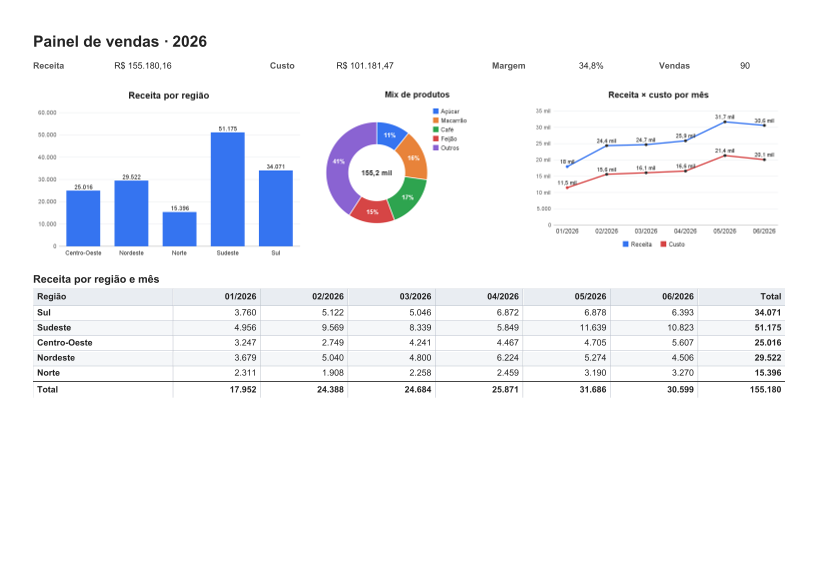
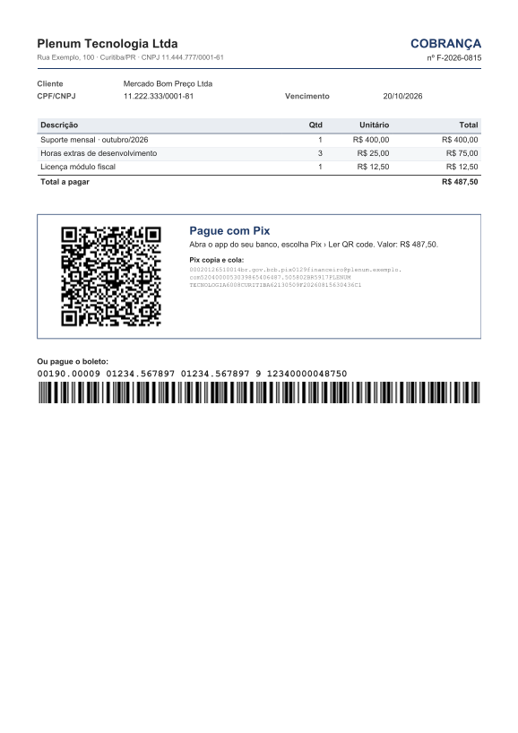
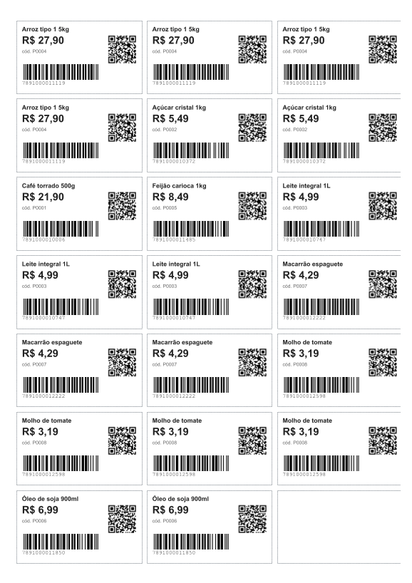
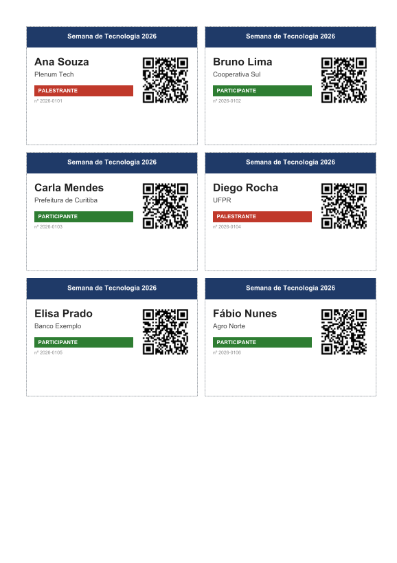
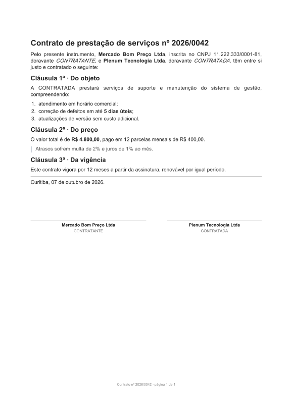
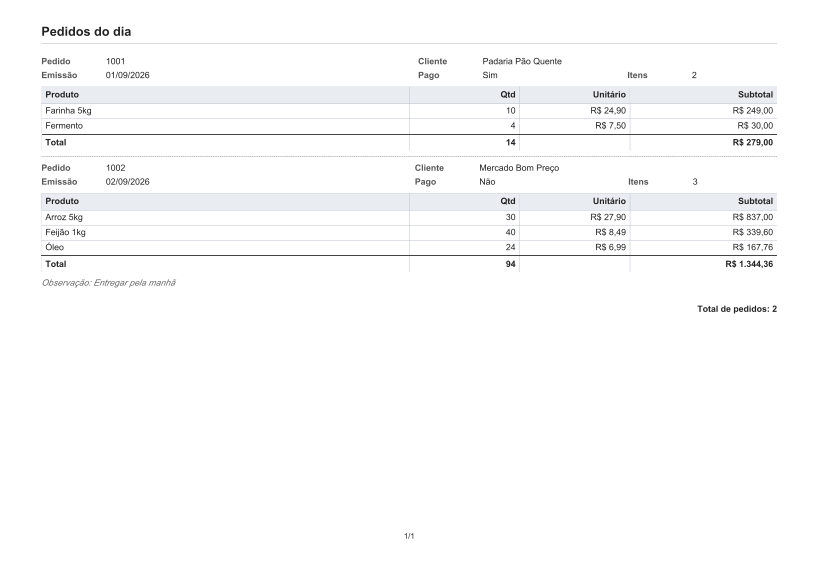

# Galeria

Exemplos prontos em [`examples/`](../examples). Cada `*.report.json` tem um `*.sample.json` ao lado; abra o
template no IntelliJ para ver o preview, ou rode:

```bash
./gradlew :relato-core:test --tests "*GaleriaTest*" -Dgaleria=true   # regenera estas imagens
```

## Painel com gráficos e tabela cruzada — [`painel.report.json`](../examples/painel.report.json)

Indicadores (`fields`), três gráficos (`bar`, `donut` com `limit` → fatia "Outros", `line` com duas séries) e um
`crosstab` região × mês com totais.



## Cobrança com Pix e boleto — [`cobranca.report.json`](../examples/cobranca.report.json)

`pix(chave, valor, nome, cidade, txid)` gera o BR Code (copia e cola) e vira QR com `barcode`. `boleto(linha)`
converte a linha digitável em 44 dígitos para o `barcode` `itf`. O PDF leva autor/assunto em `metadata`.



## Etiquetas de produto — [`etiquetas.report.json`](../examples/etiquetas.report.json)

`labels` em grade 3 × 7 (folha tipo Pimaco), `copies: "${qtd}"` imprime várias por produto, EAN-13 + QR.



## Crachás — [`crachas.report.json`](../examples/crachas.report.json)

`labels` 2 × 4 com faixa colorida. A cor da função vem de estilo com expressão:
`"background": "${funcao == 'Palestrante' ? '#c0392b' : '#2e7d32'}"`.



## Contrato — [`contrato.report.json`](../examples/contrato.report.json)

Texto longo em `markdown` (títulos, negrito, lista numerada, citação, linha) com `${...}` no meio. Os valores
são escapados: um nome com `*` ou `<` não vira marcação.



## Pedidos — [`pedidos.report.json`](../examples/pedidos.report.json)

Lista mestre-detalhe (pedido → itens) com totais.


