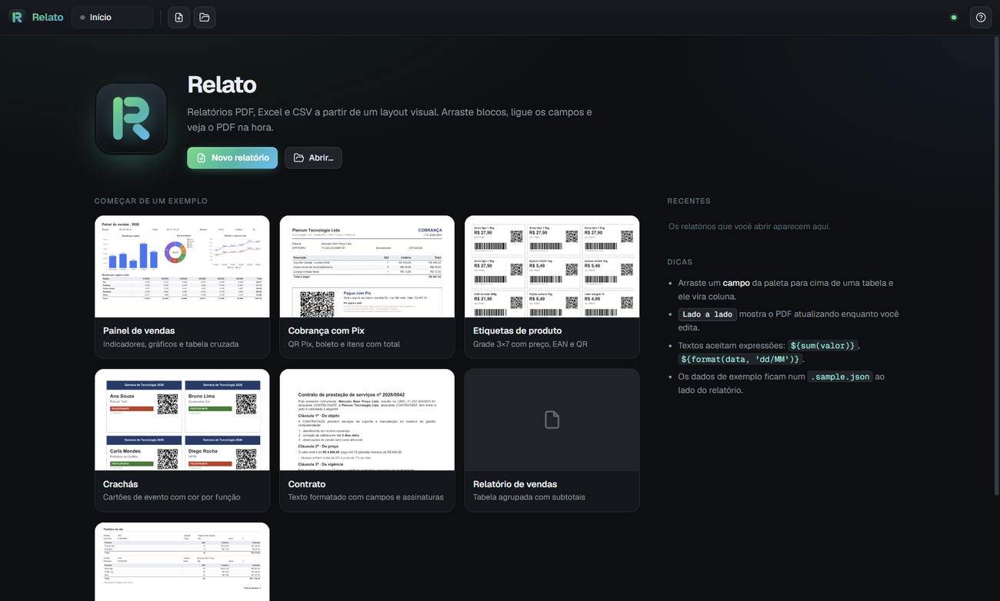

# Prelo desktop

App Windows (Electron) para montar relatórios sem IntelliJ. Usa o mesmo designer do plugin e um motor Java
embutido (o instalador traz um Java mínimo; não precisa ter Java instalado).



## O que tem
- **Tela inicial:** novo relatório, abrir, recentes e 7 exemplos com miniatura (painel, cobrança Pix, etiquetas, crachás, contrato, vendas, pedidos).
- **Designer:** o do plugin (arrastar blocos e campos, propriedades, desfazer), com o tema escuro da família Kino/Strata.
- **Lado a lado / PDF:** o preview vem do motor Java real, atualizando enquanto você edita.
- **Dados de exemplo:** editor do `.sample.json` (com *Gerar a partir dos campos*); é salvo ao lado do relatório.
- **JSON:** ver e editar o `.report.json` direto; as alterações voltam para o layout.
- **Exportar:** PDF, Excel (XLSX), CSV e HTML, com *Abrir* e *Mostrar na pasta* no aviso.
- Arrastar um `.report.json` do Explorer, abrir por linha de comando, uma instância só, aviso de alterações não salvas.
- Atalhos: Ctrl+N, Ctrl+O, Ctrl+S, Ctrl+Shift+S, Ctrl+E (PDF), Ctrl+W, F1.


## Como funciona
- `main.js`: janela, diálogos de arquivo, recentes (`%APPDATA%/prelo-desktop/recent.json`) e o processo do motor.
- `engine.js`: inicia `java -jar prelo-engine.jar engine` e conversa por JSON em linhas (stdin/stdout). Comandos: `preview`, `check`, `export`, `sample`, `schema` (ver `PreloEngine` em `prelo-server`).
- `renderer/app.js`: casca (documento, modais, exportar) e a ponte `window.preloHost` ↔ `window.prelo.receive` do designer.
- `renderer/designer/`: copiado de `prelo-intellij/src/main/resources/designer` pelo `scripts/prepare.js` (fonte única).

## Rodar e gerar o instalador
```bash
npm install
npm start            # copia designer/exemplos e usa o jar do Gradle; Java do sistema (JAVA_HOME ou PATH)
npm run dist         # jar + Java mínimo (jlink, ~49 MB) + instalador em dist/Prelo-Setup-0.1.0.exe
npm run icon         # regenera renderer/icon.png, assets/icon.ico e o ícone do plugin a partir de assets/icon.svg
```
O `jlink` usa um JDK 21 de `~/.jdks` (ou `PRELO_JLINK_JDK`). Capturas de tela automáticas:
`PRELO_SHOTS=pasta npx electron .` (abre o exemplo do painel, liga o lado a lado e salva PNGs).
